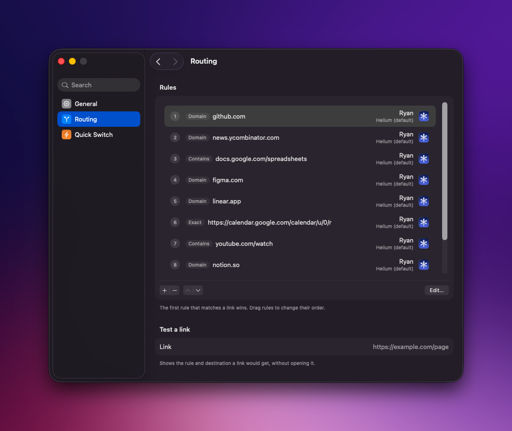

# Switchboard

**Every link opens in the right browser profile.**

Switchboard is Arc's Air Traffic Control, as its own little Mac app, for the Chromium browser you
already use. Set it as your default browser and it quietly sends each link you click, in Slack,
Mail, your terminal or anywhere else, to the browser and profile you chose for it. Work links land
in your work profile, everything else in your personal one.



## What it does

- **Rules, in order.** Match a link by domain (`github.com` and its subdomains), by text it
  contains, or exactly. The first rule that matches wins; anything else goes to your default
  profile. Test a link in Settings to see where it would go without opening it.
- **Any Chromium browser.** Chrome, Arc, Brave, Edge, Helium, Vivaldi, Opera and Chromium,
  including their beta and dev builds. Rules can mix browsers.
- **Quick Switch.** Already on a page in the wrong profile? Press ⌃⌥Space (or your own shortcut),
  type a few letters to filter, and press Return to reopen it in another profile. Choose which
  profiles show up in Settings → Quick Switch.
- **Recent Links.** See where each link went and which rule sent it there, and turn any of them
  into a new rule in one click.
- **Lives in the menu bar.** No Dock icon, no windows flashing up. It can open at login.
- **A command line too.** The `switchboard` command can read and change every setting, so you can
  script your rules or hand them to an AI agent.

## Install

Requires macOS 14 or newer on Apple silicon.

```sh
brew install --cask ryanmiville/tap/switchboard
```

Update with `brew upgrade --cask ryanmiville/tap/switchboard`.

## Set up

1. **Open Switchboard.** It appears in the menu bar. Choose Settings… from its menu.
2. **Make it your default browser.** In Settings → General, click Set Default… and confirm the
   macOS prompt. (Or pick Switchboard in System Settings → Desktop & Dock → Default web browser.)
3. **Pick a default destination** in Settings → General: the browser and profile for links no
   rule matches.
4. **Add rules** in Settings → Routing.

### Quick Switch needs Automation permission

Quick Switch reads the current tab's link from your browser, which macOS treats as Automation.
The first time you use it over a browser, macOS asks whether Switchboard may control that browser:
click **Allow**. It asks once for each browser.

If you clicked Don't Allow, the Quick Switch panel says so. Turn it back on in System Settings →
Privacy & Security → Automation → Switchboard, by switching on your browser. macOS may ask again
after Switchboard updates.

Switchboard needs no Accessibility permission. The Quick Switch shortcut works without it.
